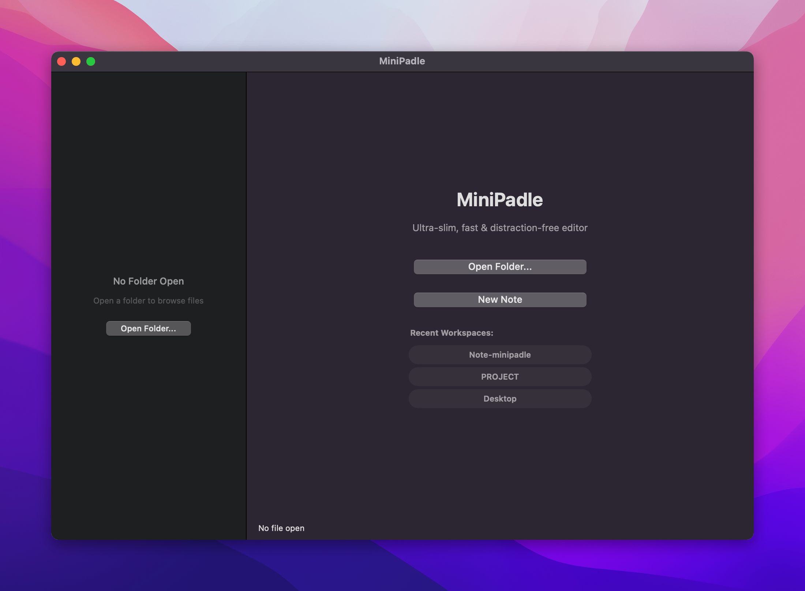
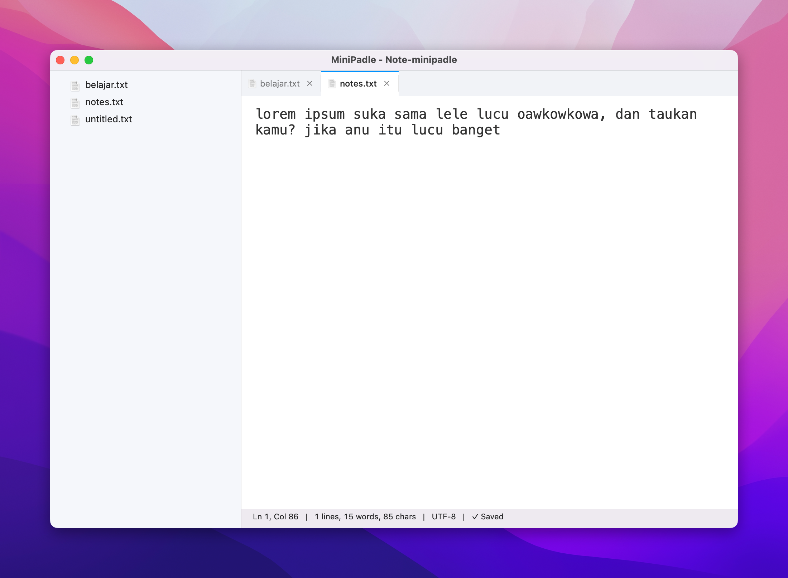
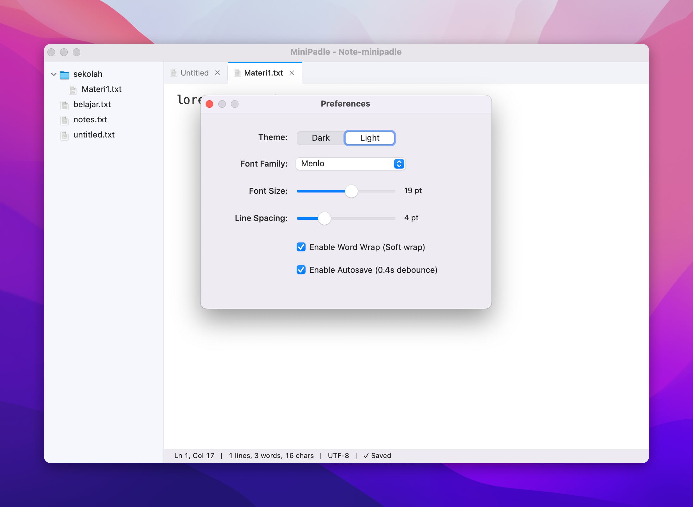

# MiniPadle

A minimal, native macOS text editor. Built with pure Objective-C and Cocoa.

### Screenshot




---

### Features

- Open any folder as workspace
- File tree with lazy loading
- Tabbed editing
- Quick Open (`Cmd+P`)
- Auto-save
- Dark mode
- Word wrap, font size, line spacing settings
- File actions: New, Rename, Delete, Copy/Cut/Paste, Reveal in Finder
- Recent folders

### Requirements

- macOS 11.0+
- Xcode Command Line Tools

### Build & Run

```bash
chmod +x build.sh
./build.sh

open MiniPadle.app
```

This will generate:
- `MiniPadle` - stripped binary
- `MiniPadle.app` - app bundle
- `MiniPadle.dmg` - installer

### Project Structure

```
src/
├── main.m
├── App/AppDelegate + Logger
├── Controllers/Editor, QuickOpen, Settings
├── Models/FileNode
└── Resources/AppIcon.icns
```

### Stack

Objective-C (MRC) + Cocoa + clang `-Oz -flto`

### License

MIT
